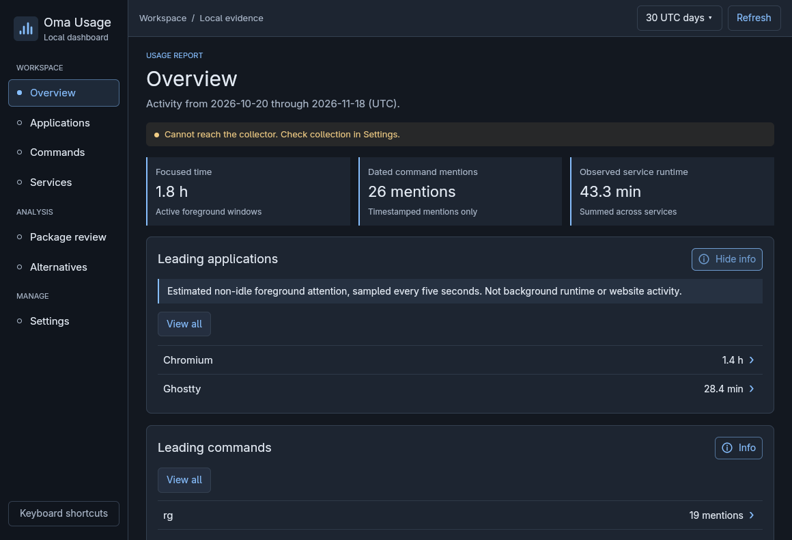

# Oma Usage

Oma Usage shows which apps had your attention, which commands appeared in Bash, and which services ran. The **Usage** button lives in the Omarchy bar. It opens a native [GPUI](https://www.gpui.rs/) dashboard. Reports stay on this device, and opening the dashboard does not start collection.



[Install](#install-through-omarchy) · [See your first observation](#see-your-first-observation) · [Use the dashboard](#using-the-dashboard) · [Troubleshoot](#troubleshooting) · [Update](#update) · [Remove](#remove)

## Omarchy baseline

This plugin is based on [Omarchy 4.5.0](https://omarchy.org/news/2026/11/omarchy-4-5/). The reviewed and tested platform is the installed **`omarchy 4.5.0-3`**, with **`quickshell 0.3.2.r7.g2b4501a-1`**, on x86_64. Older or newer Omarchy releases are not automatically assumed compatible.

The compatibility review covers the Git plugin manager, third-party widget facade, mixed service/widget manifest, native shell IPC, and lock-state query. Tracking setup preserves existing placement in all six current bar sections: `left`, `centerBegin`, `center`, `centerEnd`, `right`, and `tray`. It uses Wayland toplevel/idle APIs, not workspace-layout-specific Hyprland configuration.

The dashboard and widget text are currently English. Omarchy's new language selection does not translate them. ARM installation has not been verified.

## Install through Omarchy

Requires Python 3.12+, pacman, systemd user services, and an Omarchy shell with Git-managed plugins and mixed `service`/`bar-widget` support. Run as your normal desktop user, never root.

The dashboard needs a working Vulkan driver for your GPU. Runtime setup builds it with `/usr/bin/cargo` and `/usr/bin/rustc`. Leave several GiB free in `/var/tmp`. The first build can take tens of minutes. Install missing prerequisites yourself:

```sh
omarchy pkg add python-gobject gtk4 libadwaita rust base-devel fontconfig libxkbcommon-x11 wayland vulkan-icd-loader
```

Use Omarchy's normal plugin installation process:

```sh
omarchy plugin add https://github.com/emo333/oma-usage.git
```

Review the unsandboxed-plugin warning, enable `oma.usage`, and choose its bar section. The suggested section is right. If you added it without enabling:

```sh
omarchy plugin enable oma.usage --section right
```

Click **Usage**. First use has two separate approvals:

1. **Install local backend.** A GTK window lists the files to install before GPUI is available. Approval downloads the Python build tools and dependencies, downloads the Rust crates pinned in `dashboard/Cargo.lock`, and builds the dashboard. Canceling leaves no runtime installed.
2. **Enable local tracking.** In the dashboard, open **Settings → Local tracking setup → Enable local tracking…**. Review the exact paths, Bash history source, and collection scopes before confirming. Approval enables the user service, attempts the one-time import, and starts observation. Canceling leaves tracking off on a fresh install.

Setup briefly waits for an asynchronous Omarchy plugin scan to finish. If plugin readiness times out or its IPC call fails, the failed stage stays visible and collection stays paused. Retry from Settings after the shell is ready.

Once runtime setup finishes, you can also open **Oma Usage** from the app launcher. Use the **Usage** bar button to check for runtime updates.

Omarchy owns the installed Git checkout at `~/.config/omarchy/plugins/oma.usage`. The development repository is source only. The runtime is an installed copy in a separate virtual environment, not an editable import of either checkout. Backend setup never overwrites the plugin checkout, replaces `shell.json`, modifies `/usr/share/omarchy`, or installs native packages.

### See your first observation

1. Open **Settings → Collection** and check for **Collection enabled**. If this is your first run, complete **Local tracking setup** rather than pressing **Resume collection**.
2. Focus Chromium and use it for about 10–15 seconds while the screen is unlocked. The observer samples the foreground window every five seconds and on changes. It needs two valid snapshots to credit an interval. A new browser instance is not necessary.
3. Return to **Applications → Most observed** and select **Refresh**. Search for `chromium` or its app ID. If it is missing, open **Overview → Source health and coverage → Application focus** and check the last successful observation and any gaps.

There is no app allowlist. The collector matches the foreground app ID to a desktop entry when it can. It records an ambiguous or unmatched ID as `app-id:<id>`. Empty or unsafe IDs do not earn focus time. If you run `omp` inside Ghostty, **Applications** credits Ghostty because it owns the window. For a separate `omp` command mention, use **Commands → Open tracked terminal**, run it there, and exit back to the Bash prompt. Ordinary terminals do not publish live command mentions.

Closing the dashboard does not stop the collector. After tracking setup enables `oma-usage.service`, systemd starts it with your **graphical user session** on subsequent logins, not at machine boot before login. Pausing collection is persistent and does not disable the service.

### Update

```sh
omarchy plugin update oma.usage
```

Close the existing dashboard, then click **Usage**. If the runtime payload changed, review and approve **Install local backend**. Updating the checkout alone does not replace the installed backend. A successful rebuild restarts a previously running owned collector, preserves settings and pause state, and does not start a stopped collector. Documentation-only changes do not trigger a rebuild.

If an earlier setup stopped at a Bash startup conflict, retry **Settings → Enable local tracking** after the backend update. Completed history is not reimported. Old startup blocks and prompt hooks stop recording with the new backend, including in already-open shells. The update does not remove the old block. You can remove it manually or let the separate backend removal preview identify it.

### Remove

Remove the backend before removing the plugin:

1. In dashboard **Settings**, choose **Remove local backend…**, review the removal preview, and confirm.
2. Remove the Git-managed widget:

   ```sh
   omarchy plugin remove oma.usage
   ```

The equivalent backend CLI first previews without changes, then requires an explicit affirmative flag:

```sh
~/.local/bin/oma-usage uninstall
~/.local/bin/oma-usage uninstall --yes
```

Backend removal stops/disables the owned user service, removes the owned runtime and generated integrations, and leaves collection disabled. If a previous version added an exact managed Bash source block, the removal preview lists it separately; no other startup content is removed. Usage data, the history-import marker, and other settings are retained. Foreign or modified files are reported rather than silently deleted. Already-open tracked shells may retain their in-memory prompt hook until closed; its missing helper is quiet.

`omarchy plugin remove` only removes the plugin checkout. It has no backend uninstall hook. If you removed the plugin first, the installed `oma-usage uninstall` command still works. If you never approved runtime setup, there is no backend to remove.

### Troubleshooting

| Symptom | Action |
| --- | --- |
| Usage does not open a setup window | Check Python/native prerequisites above. Run `/usr/bin/python3 -I ~/.config/omarchy/plugins/oma.usage/bootstrap.py` from a terminal to see startup errors. |
| Dependency download or runtime build fails | Check access to crates.io and your Python package index, free space in `/var/tmp`, and the system Rust toolchain. Retry runtime setup. |
| Dashboard fails to open after a successful build | Run `~/.local/bin/oma-usage` from your graphical session. Check the Vulkan driver before changing tracking settings. |
| Setup reports a foreign or modified installation target | Review the reported file. Resolve the conflict explicitly; setup does not overwrite user files. |
| No new app time | Follow [See your first observation](#see-your-first-observation). **All inventory** may show an installed app without any focus evidence. A filtered or empty ranking does not mean the app was never used. |
| No live command mentions | Use a tracked Bash terminal, keep collection enabled, and return to its prompt. Only history-visible commands count. One-time imports with no timestamps do not appear in dated rankings. |
| History import is incomplete | Use **Settings → Bash history → Choose history file…**, select a readable Bash history file, then **Retry one-time history import**. A completed import is never replayed. |
| Collector unavailable or timed out | Old reports remain readable. A timeout does not prove the service stopped or that a control failed. Choose **Settings → Collection → Retry source status** before repeating an action. |
| `lock_state_unknown` or another unavailable source | Under **Overview → Source health and coverage**, select the affected source. Unknown lock state prevents app time, not service observations. Retrying history import will not fix app focus. |

To distinguish login startup from a live collector problem, run these read-only checks as your normal desktop user:

```sh
systemctl --user is-enabled oma-usage.service
systemctl --user is-active oma-usage.service
omarchy-shell lock isLocked
```

`enabled` means configured to start at graphical login. `active` means the service is running, not that collection is unpaused or every source is healthy. The lock query should return `false` on an unlocked desktop.

## Using the dashboard

Start in **Overview**. Select a total to open its list, or an evidence row to inspect one identity. Outlined **ⓘ Info** buttons explain what counts and what is excluded without leaving the page. The dashboard uses the Omarchy theme, with text alongside status colors. In narrow windows, **Pages** replaces the sidebar.

| Page | What to do there |
| --- | --- |
| Overview | Open a leading app, command, or service. Select a source under **Source health and coverage** to inspect recorded intervals and gaps. |
| Applications | Compare focus time, search by label or ID, and open a row for focus sessions and dated evidence. |
| Commands | Compare dated Bash mentions, inspect undated imports separately, or open a tracked terminal. |
| Services | Inspect running time and observed starts. The same unit name in user and system scope has separate evidence. |
| Package review | Switch from **Review candidates** to **All package inventory** to see why a package did or did not qualify. This page cannot uninstall packages. |
| Alternatives | Compare tools from observed sources or select **All curated use cases** to browse the offline catalog. Source links and browser searches show a destination before you open it. |
| Settings | Check live collection state, choose a history file, and manage tracking. Threshold changes take effect only after **Apply settings**. Clearing history and removing the backend have separate confirmation screens. |

Reports default to the last 30 UTC days. Use the period control for 7, 30, 90, or 365 days. The active window refreshes the current page every five seconds when no dialog or request is open. **Refresh** requests a reading now. On evidence lists, **Search…** narrows the current filter. Choose **All inventory** to include rows without dated use.

| Keyboard | Action |
| --- | --- |
| `Tab` / `Shift+Tab`, then `Enter` or `Space` | Focus and activate a control, including Info |
| `Alt+1` … `Alt+7` | Switch dashboard pages |
| `R` | Refresh the current page |
| `Esc` | Go back or cancel a preview |
| `?` / `Q` | Show shortcuts / quit |

## What the numbers mean

| Source | Metric | Important boundary |
| --- | --- | --- |
| Applications | Estimated non-idle focused seconds and focus sessions | Five-second snapshots. The idle threshold defaults to 60 seconds. No background runtime, playback, window titles, or websites. |
| Commands | History-visible syntactic mentions | Not successful executions, branch execution, loop iterations, or command duration. Arguments and executable paths are discarded. |
| Services | Observed running seconds and observed starts | User and system scopes remain separate. Already-running baselines add no starts. Active/exited oneshots add no running time. |
| Inventory | Installed packages and discovered entry points | Installation is not usage. Package install/update date is not original installation or first use. |

Most and Least lists contain positive evidence only. Zero rows distinguish **Not observed** from **Insufficient coverage**. Bash prompts establish point observations, not continuous daily coverage. Untimestamped history counts remain separate from every date-based ranking and have no fabricated last-used timestamp.

App categories sum focus time only. Curated command use cases sum mentions separately. There is no combined usage score.

## Review and alternatives

Review candidates must be explicitly installed, have tracked entry points, have been present for the stale threshold, have no recent dated signal, and have at least 30 qualifying days for every mapped source. A qualifying desktop/service day has 30 minutes of connected coverage. Bash needs a live prompt observation. Running owned services block review. Unknown ownership, dependency installs, and insufficient coverage exclude candidates.

Review details show retained evidence, undated counts, coverage, installed size, package install/update date, dependencies, and enabled/running services. Dependency relationships are refreshed read-only when details open. “Few recorded uses” means 1–5 retained mentions or focus sessions, not lifetime use. Package review provides no package-uninstall button, service-disabling action, or “safe to remove” claim. Removing Oma Usage's own backend is a separate Settings operation.

The offline catalog contains directed comparisons for text search, filename search, resource monitoring, modal editing, terminal emulation, and container workflows. Installed options come first, including already-used targets. Each comparison states its advantage, tradeoff, primary source, review date, installation status, and available usage evidence. Catalog review dates are not claims about current online releases.

Online research is optional. A confirmation previews the exact canonical-tool/use-case query and DuckDuckGo destination before opening the default browser. Unsupported tools require an editable name selection. Merely opening the dashboard or Alternatives makes no online request. Browser results are not fetched or summarized by the plugin.

## Privacy, storage, and settings

Usage evidence contains sanitized identities and aggregates, not raw history, arguments, working directories, user executable paths, document names, browsing history, or window titles. Package ownership paths used for matching are transient. Setup separately records the selected history file path and managed installation paths. The collector uses a local Unix socket and verifies that peers have the same user ID.

| Artifact | Default location |
| --- | --- |
| Usage database | `$XDG_DATA_HOME/oma-usage/usage.sqlite3` or `~/.local/share/oma-usage/usage.sqlite3` |
| Configuration | `$XDG_CONFIG_HOME/oma-usage/config.json` or `~/.config/oma-usage/config.json` |
| Tracking setup stages and selected history source | `$XDG_CONFIG_HOME/oma-usage/setup-state.json` |
| Collector socket | `$XDG_RUNTIME_DIR/oma-usage/collector.sock` |
| Launcher | `~/.local/bin/oma-usage` |
| Plugin | `~/.config/omarchy/plugins/oma.usage/` |
| Tracked Bash startup wrapper and recorder | `$XDG_DATA_HOME/oma-usage/terminal.bash` and `oma-usage.bash` in the same directory |
| Installed runtime | `$XDG_DATA_HOME/oma-usage/venv/` (includes `bin/oma-usage-dashboard`) |
| Backend ownership manifest | `$XDG_DATA_HOME/oma-usage/installed-files.json` |
| User service unit | `$XDG_CONFIG_HOME/systemd/user/oma-usage.service` |
| Desktop entry | `$XDG_DATA_HOME/applications/org.omarchy.OmaUsage.desktop` |

`XDG_RUNTIME_DIR` is required. Private directories use 0700 and configuration/database/socket files use 0600. SQLite uses WAL, foreign keys, and a single daemon writer. The dashboard opens read-only connections. Malformed configuration or an incompatible/corrupt database produces an error, not an automatic reset.

Collection defaults off. Settings permit retention of 90/365 days, stale thresholds of 30/90/180 days, and idle thresholds of 60/120/300 seconds. Daily usage and coverage expire together. Entity first/last evidence and undated imported counts survive daily expiry. Missing expired coverage cannot qualify a package for review.

Clear usage history requires confirmation. It deletes usage, coverage, and first/last evidence while retaining inventory, settings, sequence deduplication, and the completed-import marker. Previously imported Bash history is not reread after clearing.

History is imported once transactionally, including an empty snapshot. Unreadable history remains explicitly not imported. The Bash hook baselines saved history at the first prompt without replaying it as live usage. It preserves scalar/array prompt hooks and exit status, respects history omissions, and never rewrites history settings or forces history writes. Each helper invocation has a 250 ms deadline. Paused/unavailable preflight avoids reading the private record. Duplicate suppression, erased duplicates, disabled history, aliases/functions, unsupported packaging, remote activity, and undiscovered scripts remain coverage gaps.

Daemon downtime, observer reload/disconnect, idle, lock, suspend, pause, and clock discontinuities are never backfilled into app attention. An unknown lock state prevents app-time credit and qualifying desktop coverage.

## Development

See [Development and release verification](docs/development.md) for the source/runtime boundary, component responsibilities, isolated checks, and the GitHub release checklist.

